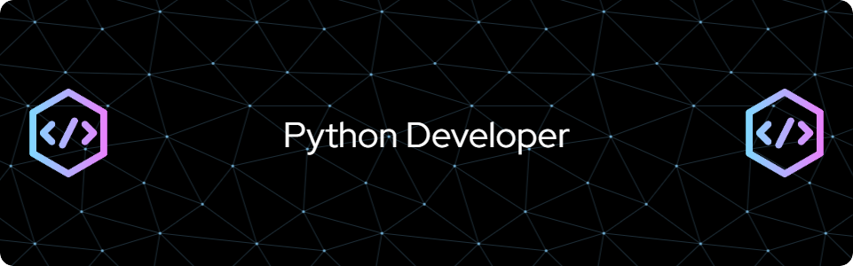

<h1 align="center">
    
</h1>

<h3 align="center">A passionate Fullstack Python developer from Ukraine</h3>

<br/>

<div align="center">
 
 🔭 I’m currently working as **a freelancer**
 
 🌱 I’m currently learning **ML, AI, LLM**

💬 Ask me about **Python, React, Databases... or anything [here](https://github.com/gamechangerslius/gamechangerslius/issues)**

```
⚡my_hobbies_are = ["books", "cycling"]
```

 </div>

 <hr/>
 
<h2 align="center">⚒️ Languages-Frameworks-Tools ⚒️</h2>
<br/>
<div align="center">
    
    <br>
</div>

<br/>
<hr/>

<div align="center">
  <h2>🐍 My Contributions 🐍</h2>
  <br>
  
  
  <br/><br/><br/>
</div>
